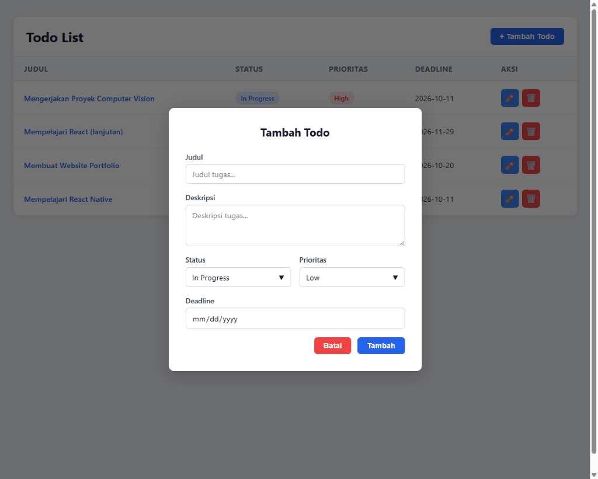
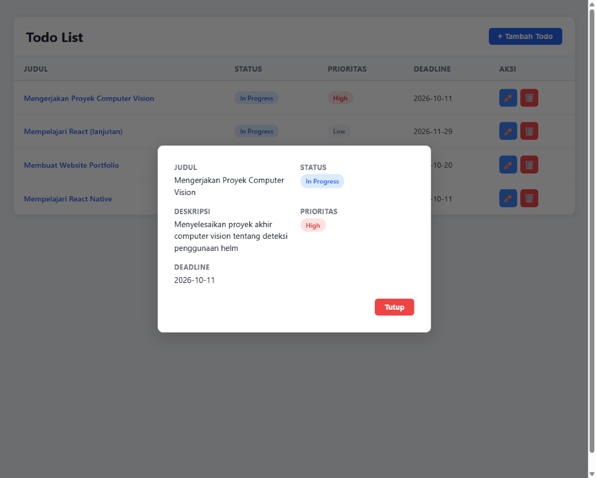

# Kuis Praktikum – Pengembangan Frontend To-Do List dengan React.js

Aplikasi To-Do List berbasis **React.js** untuk mengelola daftar tugas sehari-hari dengan antarmuka yang bersih, responsif, dan mudah digunakan.

---

## 📸 Screenshot Hasil Implementasi

### 1. Tampilan Utama (Daftar Tugas)
Menampilkan tabel daftar tugas dengan kolom Judul, Status, Prioritas, Deadline, dan Aksi (Lihat Detail & Hapus).


### 2. Modal Tambah Todo
Formulir modal untuk menambahkan tugas baru dengan validasi input.


### 3. Tampilan Detail Tugas
Menampilkan detail lengkap dari tugas yang dipilih, dilengkapi tombol **Kembali** dan **Update**.


---

## 🚀 Fitur Aplikasi

1. **Menampilkan Tugas**: Menampilkan daftar tugas dummy beserta informasi lengkap (Judul, Status, Prioritas, Deadline).
2. **Melihat Detail Tugas**: Pengguna dapat melihat informasi lengkap suatu tugas dengan mengklik tombol ikon mata (👁️).
3. **Menambahkan Tugas**: Menambah tugas baru melalui formulir modal dengan tombol "+ Tambah Todo".
4. **Memperbarui Tugas**: Mengedit tugas yang sudah ada melalui modal update dari halaman detail.
5. **Menghapus Tugas**: Menghapus tugas dengan umpan balik berupa konfirmasi pop-up sebelum penghapusan dilakukan.
6. **React State**: Seluruh pembaruan data dikelola menggunakan *React State* (`useState`) tanpa perlu me-reload halaman.
7. **Feedback Pengguna**: Dilengkapi notifikasi *toast* untuk setiap aksi (tambah, perbarui, dan hapus).

---

## 📋 Struktur Data Tugas

Setiap data tugas memiliki atribut:
| Atribut | Tipe | Keterangan |
|---|---|---|
| `id` | number | Identitas unik tugas |
| `title` | string | Judul tugas |
| `description` | string | Deskripsi tugas |
| `priority` | string | Tingkat prioritas (`low`, `medium`, `high`) |
| `deadline` | string | Batas waktu pengerjaan tugas (format `YYYY-MM-DD`) |
| `status` | string | Status pengerjaan tugas (`to-do`, `in progress`, `done`) |

---

## 🛠️ Cara Menjalankan Proyek

1. **Clone repository:**
   ```bash
   git clone https://github.com/oryzaaulia300-blip/QuizLabPW.git
   cd QuizLabPW
   ```

2. **Install dependencies:**
   ```bash
   npm install
   ```

3. **Jalankan development server:**
   ```bash
   npm run dev
   ```

4. Buka browser pada URL yang tertera di terminal (biasanya `http://localhost:5173`).
