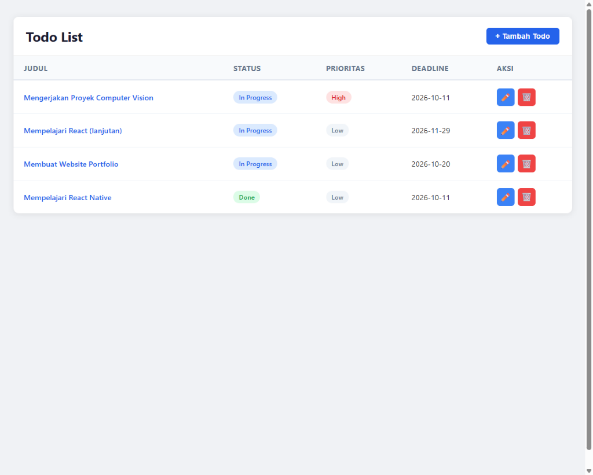

### 1. Tampilan Utama (Daftar Tugas)
Menampilkan tabel daftar tugas dengan kolom Judul, Status, Prioritas, Deadline, dan Aksi (Lihat Detail & Hapus).

### 2. Modal Tambah Todo
Formulir modal untuk menambahkan tugas baru dengan validasi input.

### 3. Tampilan Detail Tugas
Menampilkan detail lengkap dari tugas yang dipilih, dilengkapi tombol **Kembali** dan **Update**.

